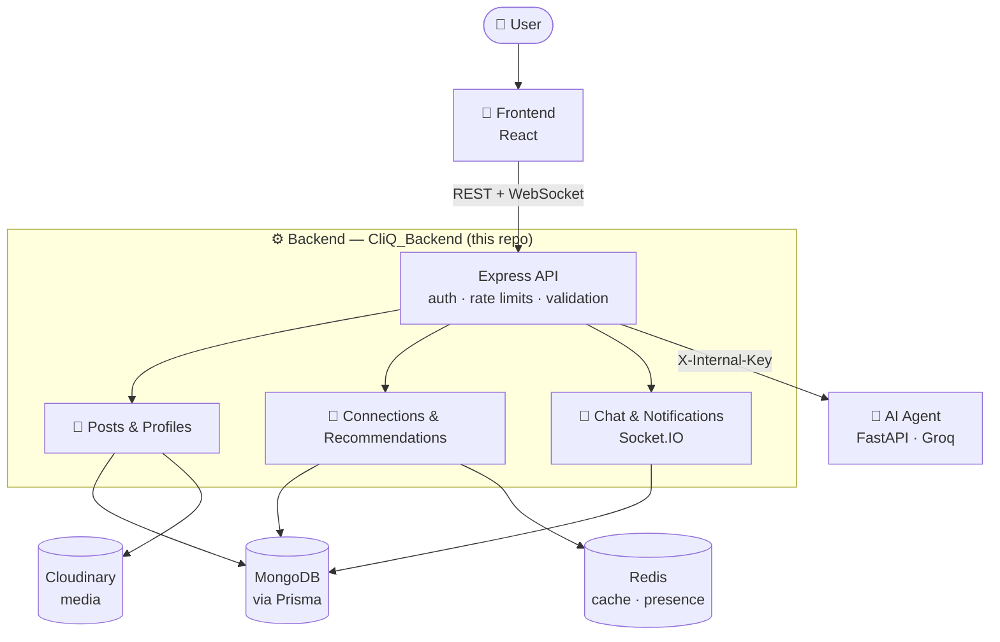

<div align="center">

# 🚀 CliQ

### Connect · Share · Collaborate

*A social + professional networking platform, powered by AI*

<br/>


<br/>

**`Post`** ➜ **`Discover`** ➜ **`Connect`** ➜ **`Chat`** ➜ **`Collaborate`**

<br/>

[🌐 Live Demo](https://cliq-web-rho.vercel.app/) &nbsp;•&nbsp;
[🎨 Frontend](https://github.com/Aman-kumar-git12/CliQ_Web) &nbsp;•&nbsp;
[⚙️ Backend](https://github.com/Aman-kumar-git12/CliQ_Backend) &nbsp;•&nbsp;
[🤖 AI Agent](https://github.com/Aman-kumar-git12/CliQ_Agent)

</div>

---

Build a profile around your **expertise**, share posts, discover the **right people** through AI-ranked
recommendations, and collaborate over **real-time chat**, with AI helping at every step.

> [!NOTE]
> This repository is the **Express API** at the center of CliQ. It handles auth, profiles, posts,
> connections, chat, notifications and search, and it is the **only** service that talks to the Python AI agent.

## 📦 Repositories

CliQ is split into three services:

| Service | Tech | Repository |
|---|---|---|
| 🎨 **Frontend** | React · Vite · Tailwind | [Aman-kumar-git12/CliQ_Web](https://github.com/Aman-kumar-git12/CliQ_Web) |
| ⚙️ **Backend** (this repo) | Node · Express · Prisma · MongoDB · Redis | [Aman-kumar-git12/CliQ_Backend](https://github.com/Aman-kumar-git12/CliQ_Backend) |
| 🤖 **AI Agent** | Python · FastAPI · Groq · Embeddings | [Aman-kumar-git12/CliQ_Agent](https://github.com/Aman-kumar-git12/CliQ_Agent) |

---

## 🧩 The Problem

Communication is easy today, but meaningful collaboration is still hard:

1. Social apps focus on entertainment, not expertise.
2. Professional platforms feel static and inactive.
3. There is no smooth path from **discovering** someone → **understanding** them → **reaching out**.
4. Messaging, networking and profile building are spread across different tools.
5. Nothing helps users present themselves well or know what to say.

Finding people is easy. Finding the **right** people, and knowing how to start, is hard.

## 💡 The Solution

CliQ puts the whole journey in one place and adds AI where it helps most: writing your profile, ranking who
you should meet, searching by meaning, and suggesting replies in chat.

---

## 🏗️ Architecture



The browser **never** calls the AI agent directly. Every AI request goes through this backend, which
authenticates the user, applies rate limits and forwards the request with a shared secret.

## 🎯 How Smart Connections Work

Opening **Get Connections** never waits for ranking or for the AI agent (which may be asleep on Render's
free tier):

1. **Embeddings are computed once.** The agent stores each profile's embedding in `profile_embeddings`
   (packed float32, ~1.5 KB per user) and loads them all at startup, so a restart doesn't re-embed anyone.
2. **Each user's ranked list is stored.** Ranking runs in the background and saves only ids, scores and
   reasons to `RecommendationList`. A request reads that list (behind a 3-minute Redis copy) and filters out
   anyone already connected, requested or skipped.
3. **Changes mark the list stale instead of deleting it.** The old list is shown immediately and re-ranked in
   the background. Lists older than 6 hours are refreshed the same way. Only a brand-new user gets quick
   "seed" picks while their first ranking runs.

## 🤖 How the CliQ AI Help Chatbot Works

A question goes through three steps: **routing** (a small, fast LLM classifies it), **retrieval** (an
embedding search over the knowledge base) and **answering** (the LLM answers only from the retrieved docs).
The answer is streamed to the user token by token. Because the bot answers only from CliQ's own documentation (RAG), it doesn't invent features that don't exist.

---

## 🛠️ Problems Solved with Tech

| Problem | How CliQ solves it | Tech |
|---|---|---|
| Finding the right people is hard | AI-ranked suggestions that improve from feedback | Embeddings (bge-small), cosine similarity, ranking |
| Recommendations are slow to compute | Computed in the background, stored, then cached | MongoDB `RecommendationList`, Redis, stale-while-revalidate |
| Keyword search misses relevant people | Search by meaning ("someone good at ML") | Semantic vector search |
| Writing a good profile is hard | AI generates the expertise section from your answers | Groq LLM (Llama 3.1) |
| Not knowing how to start or reply | AI reply suggestions inside chat | LLM + safety/routing classifiers |
| Chat must feel instant | Messages and notifications are pushed live | Socket.IO (WebSockets) |
| Users need help using the app | Help bot grounded in the app's own docs | RAG (retrieval-augmented generation) |
| Account security | Short-lived JWTs with rotating refresh tokens, email codes, rate limits, origin checks | JWT, httpOnly cookies, bcrypt, Helmet, express-rate-limit |

## ✨ Features

- 🔐 **Secure authentication**: signup/login, email verification, password reset, Google Sign-In, protected sessions
- 👤 **Profiles**: personal details, profile images, public profiles
- 🧠 **Expertise showcase** with an **AI expertise generator**
- 🤝 **Connections**: send, accept and reject requests, manage your network
- 🎯 **Smart recommendations** with feedback tracking (shown, saved, ignored, interested)
- 📝 **Posts**: create, upload images, link previews, feeds, likes, comments, saves, reports
- 💬 **Real-time chat**: files, images, voice messages, editing and deleting messages
- ✨ **AI message assistant** and 🤖 **CliQ AI chatbot**, both with streaming responses
- 🔔 **Notifications** and 🔍 **search**
- 📱 **Fully responsive** frontend

## 🧰 Tech Stack

| Layer | Technologies |
|---|---|
| **Frontend** | React 18, Vite, Tailwind CSS, Framer Motion, React Router, Socket.IO client, Vitest, Playwright |
| **Backend** | Node.js, Express 5, Prisma, MongoDB, Redis, Socket.IO, JWT, bcrypt, Zod, Cloudinary, Multer, Swagger |
| **AI Agent** | Python 3.12, FastAPI, Groq (Llama 3.1), FastEmbed (bge-small-en-v1.5), MongoDB vector store |
| **DevOps** | Docker, docker-compose, GitHub Actions, Sentry, Vercel, Render |

---

## ⚡ Getting Started

```bash
npm install                # also runs `prisma generate`
cp .env.example .env       # then fill in the required values
npm run dev                # http://localhost:2004, restarts on changes
```

`npm start` runs without auto-restart (production).

- **API reference:** http://localhost:2004/api/docs (Swagger UI), generated from the routes and their
  validation schemas. The raw OpenAPI document is at `/api/docs/openapi.json`.
- **Health:** `/api/health` (process is up) and `/api/health/ready` (database is reachable; use this one
  for uptime monitoring).
- **Whole stack in Docker:** `docker compose up --build` starts MongoDB, Redis, the agent, this API
  and the frontend with a local database (see `docker-compose.yml`).

To run everything yourself, also clone the [frontend](https://github.com/Aman-kumar-git12/CliQ_Web) and the
[AI agent](https://github.com/Aman-kumar-git12/CliQ_Agent) and follow their READMEs.

## 🧪 Tests

```bash
npm test               # Jest + Supertest against a throwaway in-memory MongoDB
```

Tests never touch the real database: `tests/helpers/env.js` sets every variable before the app loads,
emails are captured instead of sent, and the AI agent is pointed at a closed port. The first run
downloads a MongoDB binary (about 100 MB).

## 📁 Project Layout

```
src/
├── app.js             starts the server: sockets, status page, self-ping, crash handling
├── createApp.js       the Express app: middleware order, health checks, API docs, routes, errors
├── config/            index.js is the ONLY place that reads environment variables; redisClient.js
├── routes/            URL → controller mapping, one file per area
├── controllers/       request handlers, one folder per feature (auth/, posts/, chat/, ...)
├── middlewares/       authentication, validate() (zod), rate limits + origin check, the error handler
├── validation/        schemas.js: the shape of every request body and query string
├── docs/              OpenAPI document generated from the routes
├── utils/             helpers, one folder per feature matching controllers/; logger.js is shared
├── socket/            Socket.IO events
└── upload/            Cloudinary and multer setup
prisma/                schema.prisma and the seed script
tests/                 API tests; helpers/ starts the in-memory database
```

## 🔒 Sessions and Security

- **Login cookies:** a short-lived JWT (15 min) plus a refresh token (stored hashed), both httpOnly.
- **Sessions:** last 7 days; expired tokens are renewed automatically via `POST /auth/refresh`.
- **Token reuse protection:** replaying a used refresh token ends all sessions in that family.
- **Password/email change** logs out every session.
- **Email codes:** 6 digits, expire in 10 minutes, locked after 5 wrong tries.
- **Rate limits:** per IP on all routes, per IP + email on auth, per minute on AI routes.
- **Cross-site safety:** changing requests must come from an allowed `Origin`.
- **Monitoring:** Sentry errors + an `X-Request-Id` on every log and response.

See [`SECURITY.md`](SECURITY.md) for secret rotation and deployment notes.

---

## 🔗 Related Repositories

- 🌐 Live website: https://cliq-web-rho.vercel.app/
- 🎨 Frontend: https://github.com/Aman-kumar-git12/CliQ_Web
- 🤖 AI Agent: https://github.com/Aman-kumar-git12/CliQ_Agent
